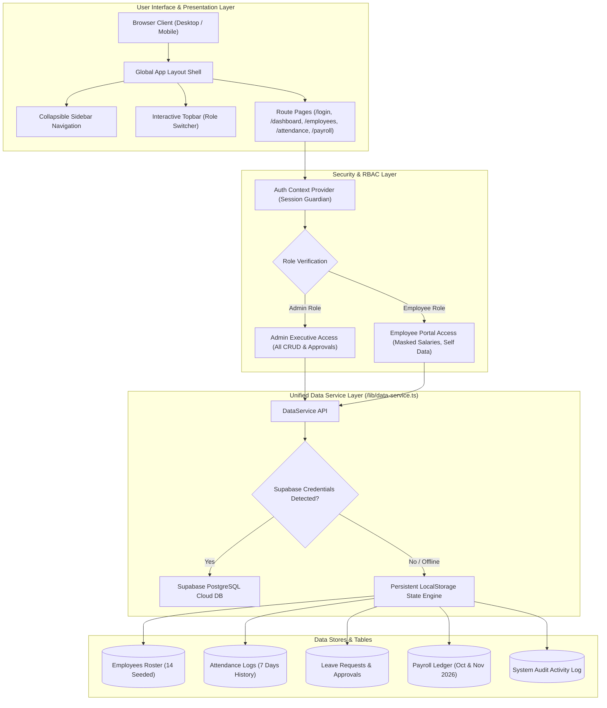
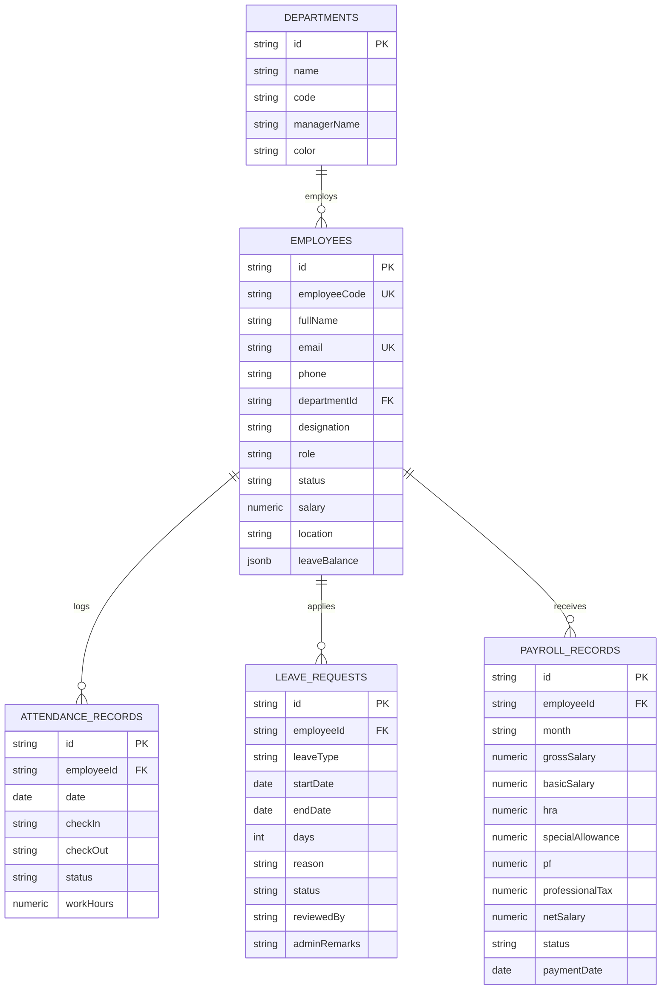

# Comprehensive Project Documentation: Enterprise Employee Management System (EMS Core)
**Course:** Non-Teaching Credit Course (NTCC) Technical Project Report  
**Degree:** Bachelor of Technology in Computer Science & Engineering (B.Tech CSE)  
**Project Title:** Cloud-Native Enterprise Employee Management & Payroll System with Dynamic Fallback Architecture  
**Author / Engineering Team:** Department of Computer Science & Engineering  
**Version:** 1.0.0 (Phase 1–4 Complete)  
**Date of Release:** November 2026  

---

## Table of Contents
1. [Project Overview & Objectives](#1-project-overview--objectives)
   - 1.1 Problem Statement
   - 1.2 Proposed Solution & Scope
   - 1.3 Key Project Deliverables
2. [System Architecture & Technology Stack](#2-system-architecture--technology-stack)
   - 2.1 Architectural Paradigm
   - 2.2 Technology Stack Justification
   - 2.3 System Architecture Diagram (Mermaid)
3. [Database Schema & Entity-Relationship (ER) Model](#3-database-schema--entity-relationship-er-model)
   - 3.1 Entity Schema Definitions
   - 3.2 Entity-Relationship Diagram (Mermaid)
4. [Module-by-Module Functional Breakdown](#4-module-by-module-functional-breakdown)
   - 4.1 Module 1: Authentication & Role-Based Access Control (RBAC)
   - 4.2 Module 2: Dual-Persona Analytics Dashboard Shell
   - 4.3 Module 3: Employee Directory & Advanced CRUD Management
   - 4.4 Module 4: Daily Attendance & Leave Approval Workflow
   - 4.5 Module 5: Automated Statutory Payroll & Printable Payslip Engine
5. [System Test Cases & Quality Assurance](#5-system-test-cases--quality-assurance)
6. [Future Enhancements & Scalability Roadmap](#6-future-enhancements--scalability-roadmap)
7. [Installation, Build & Execution Guide](#7-installation-build--execution-guide)

---

## 1. Project Overview & Objectives

### 1.1 Problem Statement
In modern mid-sized enterprises, traditional Human Resource Management Systems (HRMS) often present major operational bottlenecks:
- **Disjointed Systems:** Disconnected spreadsheets or legacy desktop applications lead to data silos, duplicate entry, and error-prone payroll processing.
- **Fragile Cloud Dependencies:** High reliance on uninterrupted cloud database connections can freeze local branch operations during network brownouts.
- **Inefficient Leave & Attendance Tracking:** Manual leave requisition slips and punch registers lack real-time visibility into employee availability.
- **Statutory Non-Compliance:** Lack of automated tax, Employee Provident Fund (EPF), and Professional Tax (PT) calculations increases legal audit risks under Indian labor regulations.

### 1.2 Proposed Solution & Scope
**EMS Core** is an enterprise-grade, cloud-native Employee Management Web Application designed to unify employee directory administration, daily attendance logging, self-service leave requisitioning, and automated statutory payroll generation into a cohesive web platform.

The system features an **Autonomous Dual-Mode Data Layer**:
- **Cloud Mode:** Integrates seamlessly with a Supabase PostgreSQL backend whenever active API keys and network connectivity exist.
- **Persistent Local Engine Fallback:** Automatically intercepts data operations when offline or when unconfigured, using structured `localStorage` with reactive state synchronization and 14 pre-seeded Indian staff profiles. This ensures **zero-configuration instant preview** and uninterrupted offline capability.

### 1.3 Key Project Deliverables
1. **Unified Data & Fallback Layer (`/lib/data-service.ts`):** Complete abstraction of CRUD operations, shift records, leave requests, and payroll disbursements.
2. **Role-Based Access Control (RBAC):** Strict view and action demarcation between **HR Administrators** and **Regular Employees**.
3. **Responsive High-Contrast UI:** Modern dark minimalist theme (`#09090b` / `#121214`) engineered with Tailwind CSS and Lucide React icons.
4. **Interactive Attendance Timecard:** Live digital clock, active shift timer, office vs. remote punch modes, and automatic work-hour computation.
5. **Interactive Payroll & Formal Payslip Generator:** Calculation of gross salary, basic pay (50%), HRA (20%), allowances (30%), EPF deductions (12%), and professional tax (₹200), with a dedicated formal print/PDF view.

---

## 2. System Architecture & Technology Stack

### 2.1 Architectural Paradigm
The application employs Next.js 16 App Router architecture utilizing the React 19 Client Component model (`'use client'`) for reactive UI interactions alongside localized storage state synchronization.

```
Client Tier (Next.js 16 App Router + React 19 + Tailwind CSS)
      │
      ├── UI Layer: Shell, Topbar, Sidebar, Data Visualizations
      │
      ├── Authentication & RBAC Engine: AuthContext + Session Storage
      │
      └── Unified Data Service Abstraction (/lib/data-service.ts)
            │
            ├── [Condition: NEXT_PUBLIC_SUPABASE_* keys configured?]
            │         │
            │         ├── YES ──► Supabase Managed PostgreSQL Database
            │         │
            │         └── NO  ──► LocalStorage Persistent Engine
            │                       (Pre-seeded with 14 Indian Staff & Logs)
```

### 2.2 Technology Stack Justification
- **Framework:** Next.js 16 (App Router) — Provides enterprise routing, pre-rendering, route segmentation, and optimal client bundle splitting.
- **Language:** TypeScript 5.7+ — Ensures strict compile-time type verification across all data entities, eliminating runtime null-pointer exceptions.
- **Styling:** Tailwind CSS 3.4 — Utility-first styling framework enabling high-contrast minimalist dark surfaces (`#09090b`, `#121214`, `#18181b`) and responsive layout breakpoints.
- **Iconography:** Lucide React — Accessible, lightweight SVG icon package.
- **Backend / Database:** Supabase (`@supabase/supabase-js`) & Browser Storage API (`Window.localStorage`).
- **Formatting Utilities:** Native `Intl.NumberFormat` for Indian Rupee (`INR / ₹`) and algorithmic Indian number-to-words currency conversion.

### 2.3 System Architecture Diagram



---

## 3. Database Schema & Entity-Relationship (ER) Model

### 3.1 Entity Schema Definitions

#### Table 1: `employees`
Stores complete organizational profile details for staff members.
| Column | Data Type | Constraints | Description |
| :--- | :--- | :--- | :--- |
| `id` | VARCHAR(64) | PRIMARY KEY | Unique employee record ID (`emp-XXXX`) |
| `userId` | VARCHAR(64) | NULLABLE | Associated user account credential ID |
| `employeeCode` | VARCHAR(32) | UNIQUE, NOT NULL | Organization badge code (e.g., `EMP-1001`) |
| `firstName` | VARCHAR(64) | NOT NULL | Employee given name |
| `lastName` | VARCHAR(64) | NOT NULL | Employee surname |
| `fullName` | VARCHAR(128)| NOT NULL | Concatenated display name |
| `email` | VARCHAR(128)| UNIQUE, NOT NULL | Official corporate email address |
| `phone` | VARCHAR(32) | NOT NULL | Contact number (+91 Indian Standard) |
| `departmentId` | VARCHAR(64) | FOREIGN KEY | Reference to `departments.id` |
| `departmentName`| VARCHAR(64)| NOT NULL | Department name redundancy for speed |
| `designation` | VARCHAR(128)| NOT NULL | Functional job title |
| `role` | VARCHAR(16) | CHECK ('admin', 'employee') | RBAC privilege group |
| `joiningDate` | DATE | NOT NULL | Date of organizational onboarding |
| `status` | VARCHAR(16) | CHECK ('active', 'on_leave', 'remote', 'terminated', 'inactive') | Employment status |
| `salary` | NUMERIC(12,2)| NOT NULL | Annual Cost to Company (CTC) in INR |
| `location` | VARCHAR(64) | NOT NULL | Base office location |
| `avatarUrl` | VARCHAR(512)| NOT NULL | HTTPS link to profile avatar image |
| `leaveBalance` | JSONB | NOT NULL | Embedded object: `{"sick": X, "casual": Y, "earned": Z}` |

#### Table 2: `departments`
Stores functional divisional hierarchies.
| Column | Data Type | Constraints | Description |
| :--- | :--- | :--- | :--- |
| `id` | VARCHAR(64) | PRIMARY KEY | Department identifier (`dept-1`, etc.) |
| `name` | VARCHAR(64) | UNIQUE, NOT NULL | Department title (e.g., *Engineering*) |
| `code` | VARCHAR(16) | UNIQUE, NOT NULL | Abbreviated division code (e.g., *ENG*) |
| `description` | TEXT | NOT NULL | Divisional mission statement |
| `managerId` | VARCHAR(64) | NOT NULL | Lead employee ID |
| `managerName` | VARCHAR(128)| NOT NULL | Name of department director |
| `color` | VARCHAR(16) | NOT NULL | Pastel hex color code for visual charts |

#### Table 3: `attendance_records`
Maintains daily shift punch-in, punch-out, and mode logs.
| Column | Data Type | Constraints | Description |
| :--- | :--- | :--- | :--- |
| `id` | VARCHAR(64) | PRIMARY KEY | Unique attendance entry ID (`att-XXXX`) |
| `employeeId` | VARCHAR(64) | FOREIGN KEY | Reference to `employees.id` |
| `employeeName` | VARCHAR(128)| NOT NULL | Snapshot of employee name |
| `date` | DATE | NOT NULL | Date of shift (YYYY-MM-DD) |
| `checkIn` | VARCHAR(16) | NULLABLE | Formatted check-in time (`09:15 AM`) |
| `checkOut` | VARCHAR(16) | NULLABLE | Formatted check-out time (`06:30 PM`) |
| `status` | VARCHAR(16) | CHECK ('present', 'absent', 'half_day', 'on_leave', 'remote') | Attendance classification |
| `workHours` | NUMERIC(4,2)| DEFAULT 0 | Computed billable shift duration |

#### Table 4: `leave_requests`
Maintains staff paid-time-off (PTO) applications and decision audit trails.
| Column | Data Type | Constraints | Description |
| :--- | :--- | :--- | :--- |
| `id` | VARCHAR(64) | PRIMARY KEY | Request identifier (`leave-XXXX`) |
| `employeeId` | VARCHAR(64) | FOREIGN KEY | Reference to `employees.id` |
| `employeeName` | VARCHAR(128)| NOT NULL | Applicant name |
| `departmentName`| VARCHAR(64)| NOT NULL | Applicant division |
| `leaveType` | VARCHAR(16) | CHECK ('sick', 'casual', 'earned') | Leave allocation category |
| `startDate` | DATE | NOT NULL | Inclusive start date |
| `endDate` | DATE | NOT NULL | Inclusive end date |
| `days` | INT | NOT NULL | Total business days requested |
| `reason` | TEXT | NOT NULL | Justification for time off |
| `status` | VARCHAR(16) | CHECK ('pending', 'approved', 'rejected') | Workflow status |
| `appliedOn` | DATE | NOT NULL | Application submission date |
| `reviewedBy` | VARCHAR(128)| NULLABLE | Name of acting HR administrator |
| `reviewedAt` | DATE | NULLABLE | Decision date |
| `adminRemarks` | TEXT | NULLABLE | Optional review notes / handover condition |

#### Table 5: `payroll_records`
Maintains monthly compensation disbursements, allowances, and statutory tax deductions.
| Column | Data Type | Constraints | Description |
| :--- | :--- | :--- | :--- |
| `id` | VARCHAR(64) | PRIMARY KEY | Payslip record ID (`pay-XXXX`) |
| `employeeId` | VARCHAR(64) | FOREIGN KEY | Reference to `employees.id` |
| `employeeCode` | VARCHAR(32) | NOT NULL | Employee badge ID |
| `employeeName` | VARCHAR(128)| NOT NULL | Payee full name |
| `designation` | VARCHAR(128)| NOT NULL | Staff title |
| `departmentName`| VARCHAR(64)| NOT NULL | Division |
| `month` | VARCHAR(32) | NOT NULL | Billing cycle (e.g., *November 2026*) |
| `grossSalary` | NUMERIC(10,2)| NOT NULL | Monthly gross salary (CTC / 12) |
| `basicSalary` | NUMERIC(10,2)| NOT NULL | Basic pay (50% of gross) |
| `hra` | NUMERIC(10,2)| NOT NULL | House Rent Allowance (20% of gross) |
| `specialAllowance`| NUMERIC(10,2)| NOT NULL | Special Allowance (30% of gross) |
| `allowances` | NUMERIC(10,2)| NOT NULL | Total allowances (HRA + Special) |
| `pf` | NUMERIC(10,2)| NOT NULL | Employee Provident Fund (12% of basic) |
| `professionalTax`| NUMERIC(10,2)| NOT NULL | Statutory PT (₹200) |
| `leaveDeductions`| NUMERIC(10,2)| DEFAULT 0 | Unpaid absence deduction |
| `deductions` | NUMERIC(10,2)| NOT NULL | Total statutory deductions (PF + PT) |
| `netSalary` | NUMERIC(10,2)| NOT NULL | Final net take-home salary |
| `status` | VARCHAR(16) | CHECK ('paid', 'processing', 'pending') | Disbursement status |
| `paymentDate` | DATE | NOT NULL | Bank disbursement settlement date |

### 3.2 Entity-Relationship Diagram



---

## 4. Module-by-Module Functional Breakdown

### 4.1 Module 1: Authentication & Role-Based Access Control (RBAC)
- **Files:** `/app/login/page.tsx`, `/lib/auth-context.tsx`, `/components/dashboard-shell.tsx`
- **Functional Description:**
  - Provides a high-contrast dark login page with ambient glow effects and standard work email/password authentication.
  - Features **1-Click Demo Personas** enabling instant evaluation without requiring credential entry:
    - **Admin:** Priya Iyer (`priya.iyer@company.com`) — Head of People & Culture.
    - **Employee:** Rohan Kulkarni (`rohan.kulkarni@company.com`) — Staff Backend Engineer.
  - Integrates an interactive Topbar **Persona Switcher** allowing instant live role toggling without page reload.
  - Restricts unauthorized access to management operations (e.g., adding employees, executing payroll runs, or approving leave).

### 4.2 Module 2: Dual-Persona Analytics Dashboard Shell
- **Files:** `/app/dashboard/page.tsx`, `/components/dashboard/admin-overview.tsx`, `/components/dashboard/employee-overview.tsx`
- **Functional Description:**
  - **Admin View:**
    - 4 Primary KPI cards: *Total Headcount (14)*, *Active Departments (4)*, *On Leave Today (2)*, and *Pending Requests (3)*.
    - Department Headcount Distribution visual breakdown chart showing headcount, percentages, and division leads.
    - Quick Approval Panel: Allows direct approval or rejection of pending leaves from the dashboard.
    - Real-Time System Audit Log Feed tracking attendance punches, leaves, and payroll payouts.
  - **Employee View:**
    - Personal Profile Hero Card with badge ID, designation, office location, and joining date.
    - Daily Attendance Widget with live clock, punch actions, and logged hours counter.
    - Leave Quota cards (Sick, Casual, Earned) with visual percentage progress bars.
    - My Submitted Leave History Table.

### 4.3 Module 3: Employee Directory & Advanced CRUD Management
- **Files:** `/app/employees/page.tsx`, `/components/employees/employee-profile-drawer.tsx`, `/components/employees/employee-form-drawer.tsx`, `/components/employees/delete-confirm-dialog.tsx`
- **Functional Description:**
  - Real-time search across Name, Employee Code (`EMP-XXXX`), Email, and Designation.
  - Multi-filtering by Department, Status (*Active, On Leave, Remote, Terminated*), and Office Location.
  - Sortable columns for Employee ID, Name, Department, Date of Joining, and Annual CTC.
  - Client-side pagination (8 rows per page) with Table View and Card Grid View toggles.
  - **Create Employee Drawer (Admin Only):** Auto-computes next sequential code (`EMP-1015`), validates Indian phone (`+91`), sets salary and custom leave quotas, and logs an onboarding audit event.
  - **Detailed Profile Slide-Over Drawer:** Displays personal contact, organization hierarchy, leave balances, and attendance status. **Hides sensitive salary figures from regular employees**, displaying an authorized view only to HR Admins.
  - **Administrative Management:** Provides full edit capabilities, soft-termination (retaining historic payroll/attendance), and permanent deletion with self-deletion guards.

### 4.4 Module 4: Daily Attendance & Leave Approval Engine
- **Files:** `/app/attendance/page.tsx`, `/components/attendance/live-clock-banner.tsx`, `/components/attendance/admin-leave-queue.tsx`, `/components/attendance/leave-application-modal.tsx`
- **Functional Description:**
  - **Live Shift Banner:** Real-time clock and active shift timer tracking elapsed duration in seconds. Provides **Clock In (Office)**, **Clock In (Remote)**, and **Clock Out (End Shift)** buttons that compute exact decimal work hours.
  - **Admin Attendance Roster:** Date selector defaulting to today with **past 7 days of historical logs** (98 entries pre-seeded), status summary filters (*Present: X, Remote: Y, Half Day: W, On Leave: Z*), and employee search.
  - **Employee Punctuality View:** Personal historical timecard logs, average daily hours, and on-time adherence rate.
  - **Leave Application Modal:** Validates date order, auto-computes inclusive working days, and warns/blocks if requested days exceed remaining quota.
  - **Admin Leave Approval Queue:** One-click Approve/Reject with an **Optional Admin Remarks input field**. Approving automatically:
    1. Deducts days from the employee's matching quota.
    2. Marks employee status as `On Leave` if today falls within the range.
    3. Synchronizes today's attendance roster to `on_leave`.
    4. Logs an audit entry in the activity feed.

### 4.5 Module 5: Automated Statutory Payroll & Printable Payslip Engine
- **Files:** `/app/payroll/page.tsx`, `/components/payroll/payslip-modal.tsx`, `/lib/data-service.ts`
- **Functional Description:**
  - **Payroll Summary KPIs:** Monthly Gross Payroll, Total Deductions, Net Disbursable Amount, and Paid vs. Pending status count.
  - **"Run Monthly Payroll" Action:** Automatically iterates over active staff, calculates monthly gross from Annual CTC, and applies Indian statutory formulas:
    $$\text{Monthly Gross} = \frac{\text{Annual CTC}}{12}$$
    $$\text{Basic Pay} = 0.50 \times \text{Gross}$$
    $$\text{HRA} = 0.20 \times \text{Gross}$$
    $$\text{Special Allowance} = 0.30 \times \text{Gross}$$
    $$\text{EPF Deduction} = 0.12 \times \text{Basic}$$
    $$\text{Professional Tax (PT)} = ₹200$$
    $$\text{Net Salary} = \text{Gross} - (\text{EPF} + \text{PT})$$
  - **Bulk Disbursement:** One-click **"Disburse All Pending"** action to transition all records to `Paid`.
  - **Digital Payslip Modal & Formal Print View:**
    - Corporate letterhead with GSTIN/CIN particulars.
    - Itemized earnings table vs. itemized deductions table.
    - Highlighted Net Payable Amount in numbers (`₹1,42,300`) and Indian currency words (*One Lakh Forty-Two Thousand Three Hundred Rupees Only*).
    - **Print / PDF Engine:** Utilizes clean `@media print` rules to render a crisp black-and-white formal A4 payslip document, hiding dark dashboard UI shells.

---

## 5. System Test Cases & Quality Assurance

| Test ID | Module | Test Scenario | Input / Action | Expected Result | Status |
| :---: | :---: | :--- | :--- | :--- | :---: |
| **TC-01** | Auth | 1-Click Demo Login as Admin | Click "HR Manager / Admin" demo button on `/login` | Authenticates Priya Iyer, redirects to `/dashboard`, enables Admin controls | **PASS** |
| **TC-02** | Auth | Topbar Persona Switching | Click "Switch Role" dropdown in Topbar and select "Employee" | Instantly swaps persona to Rohan Kulkarni, hides Admin-only actions without reload | **PASS** |
| **TC-03** | RBAC | Route Protection Guard | Access `/employees` or Admin actions as Employee | Deletion, "+ Add Employee", and approval buttons are hidden; salary is masked | **PASS** |
| **TC-04** | Directory | Advanced Search & Multi-Filter | Type "Bengaluru" in search and select Department: "Engineering" | Table filters in real-time to matching staff; live count badge updates | **PASS** |
| **TC-05** | Directory | Onboard New Employee | Fill Add Employee form with `EMP-1015` and submit | Validates inputs, saves to storage, increases total headcount, logs activity | **PASS** |
| **TC-06** | Directory | Soft Termination vs Deletion | Select "Mark as Terminated" in delete dialog | Employee status changes to `terminated`; active dashboard headcount decrements | **PASS** |
| **TC-07** | Attendance | Live Shift Punch-In & Out | Click "Clock In (Office)", wait, then click "Clock Out" | Status changes from `Not Checked In` to `Present` to `Shift Completed`, computes hours | **PASS** |
| **TC-08** | Attendance | Historical Roster Date Filter | Select date "16 Nov 2026" from date dropdown | Displays 14 completed staff timecards with punch in/out and logged hours | **PASS** |
| **TC-09** | Leaves | Form Validation & Quota Limit | Request 15 days of Casual Leave (Quota: 6) | Form displays validation warning and blocks submission | **PASS** |
| **TC-10** | Leaves | Leave Approval & Auto-Deduction | Admin enters remark "Approved" and clicks "Approve Leave" | Quota decrements by duration, status set to approved, activity logged | **PASS** |
| **TC-11** | Payroll | Run Monthly Payroll Generator | Click "Run November 2026 Payroll" as Admin | Computes Basic (50%), HRA (20%), EPF (12%), PT (₹200) for all staff | **PASS** |
| **TC-12** | Payroll | Formal Payslip PDF / Print View | Click "View Payslip" and click "Print / Save as PDF" | Modal opens with itemized earnings/deductions; print stylesheet formats clean A4 page | **PASS** |

---

## 6. Future Enhancements & Scalability Roadmap

1. **Biometric IoT Integration:** RESTful webhook endpoints to receive automated check-in and check-out logs from biometric fingerprint and RFID turnstiles.
2. **Income Tax & Section 80C Declarations:** Form 12BB self-declaration portal allowing employees to submit investment proofs (PPF, ELSS, Medical Insurance) for real-time TDS deductions.
3. **Automated Notification Dispatcher:** Integration with SendGrid / Resend API to trigger automated email payslips and Slack alerts on leave approvals.
4. **Multi-Currency Global Payroll:** Extending the salary engine to support USD, EUR, and GBP for international remote workforce distribution.

---

## 7. Installation, Build & Execution Guide

### Prerequisites
- Node.js version 18.17.0 or higher (v24 LTS recommended)
- npm version 9.0.0 or higher

### Steps to Run Locally
1. **Clone or Open Repository:**
   ```powershell
   cd "c:\Users\saksh\OneDrive\Desktop\EMQ"
   ```
2. **Install Dependencies:**
   ```powershell
   npm install
   ```
3. **Execute Production Build Verification:**
   ```powershell
   npx tsc --noEmit
   npm run build
   ```
4. **Launch Local Development Server:**
   ```powershell
   npm run dev
   ```
5. **Open Browser:**
   Navigate to **`http://localhost:3000`** in Google Chrome or any modern browser. Use the 1-click demo personas on `/login` or the Topbar role switcher to explore the complete Employee Management System.

