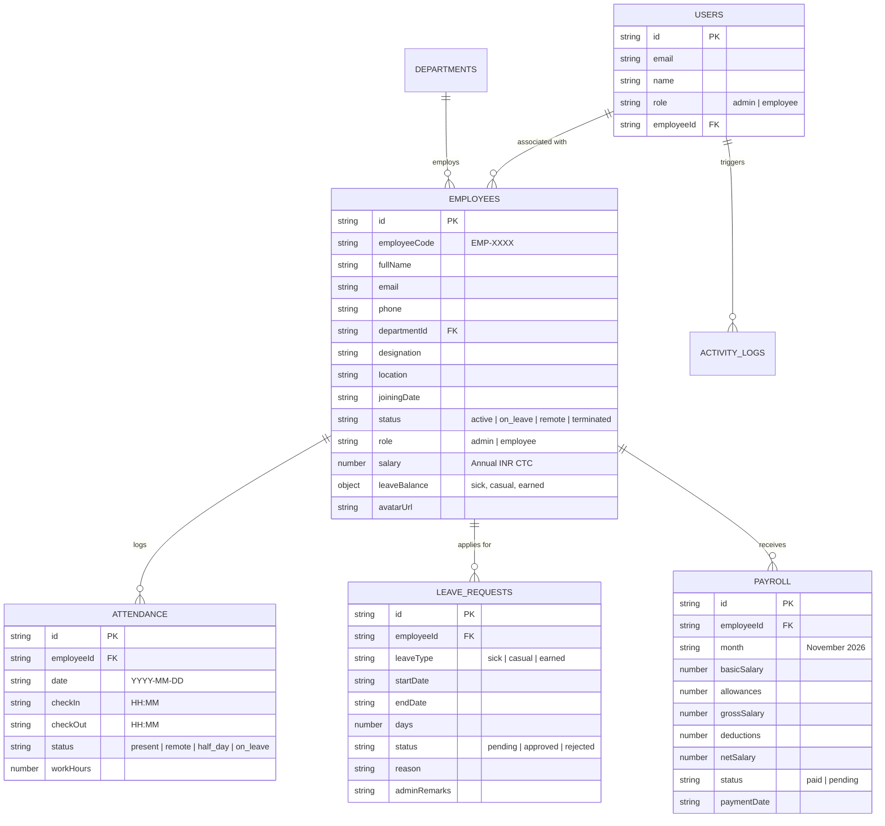

# Enterprise Employee Management System (EMS Core)

[](https://nextjs.org/)
[](https://react.dev/)
[](https://www.typescriptlang.org/)
[](https://tailwindcss.com/)
[](https://supabase.com/)
[](LICENSE)
[](#10-academic-project-context-ntcc)

> **EMS Core** is an enterprise-grade, cloud-native Employee Management and Payroll Web Application engineered using Next.js 15 (App Router), React 19, TypeScript, and Tailwind CSS. Built with an autonomous dual-mode data layer that couples Supabase PostgreSQL with a reactive, client-persistent LocalStorage fallback engine, the system delivers zero-configuration instant preview, strict Role-Based Access Control (RBAC), live attendance tracking, leave approval workflows, and automated Indian statutory payroll processing.

---

## 📑 Table of Contents
1. [Executive Summary & Problem Statement](#1-executive-summary--problem-statement)
2. [Key Capabilities & Innovations](#2-key-capabilities--innovations)
3. [System Architecture & Data Layer](#3-system-architecture--data-layer)
4. [In-Depth Module Breakdown](#4-in-depth-module-breakdown)
   - [Module 1: Authentication & Role-Based Access Control (RBAC)](#module-1-authentication--role-based-access-control-rbac)
   - [Module 2: Dual-Persona Analytics Dashboard Shell](#module-2-dual-persona-analytics-dashboard-shell)
   - [Module 3: Employee Directory & Advanced CRUD Engine](#module-3-employee-directory--advanced-crud-engine)
   - [Module 4: Attendance Tracking & Leave Workflow](#module-4-attendance-tracking--leave-workflow)
   - [Module 5: Statutory Indian Payroll & Formal Payslip Engine](#module-5-statutory-indian-payroll--formal-payslip-engine)
5. [Design Philosophy & Fluid Micro-Interactions](#5-design-philosophy--fluid-micro-interactions)
6. [Data Schema & Entity-Relationship Model](#6-data-schema--entity-relationship-model)
7. [Pre-Seeded Organization & Employee Personas](#7-pre-seeded-organization--employee-personas)
8. [Directory Structure & Code Map](#8-directory-structure--code-map)
9. [Installation, Setup & Deployment Guide](#9-installation-setup--deployment-guide)
10. [Academic Project Context (NTCC)](#10-academic-project-context-ntcc)
11. [License & Acknowledgments](#11-license--acknowledgments)

---

## 1. Executive Summary & Problem Statement

### The Problem
Traditional Human Resource Management Systems (HRMS) in growing mid-sized enterprises often face significant operational challenges:
- **Fragmented Tooling:** Disjointed tools for employee records, punch cards, leave sheets, and salary slips result in data duplication and administrative friction.
- **Hard Cloud Dependency:** Systems that depend entirely on uninterrupted network connections fail completely during local network brownouts or outages.
- **Lack of Transparent Self-Service:** Employees often lack visibility into their live check-in hours, leave approval statuses, and itemized salary deductions.
- **Statutory Non-Compliance:** Calculating statutory deductions (EPF 12%, Professional Tax, HRA) manually on spreadsheets introduces severe tax non-compliance and payroll audit risks under Indian labor regulations.

### The Solution: EMS Core
EMS Core provides a centralized, role-aware solution that unifies:
- **Instant Cloud / Offline Operation:** Runs seamlessly with cloud Supabase PostgreSQL when credentials exist, and falls back gracefully to a reactive, browser-persistent state engine populated with realistic seeded data when offline.
- **Role-Based Access Control (RBAC):** Clean segregation of duties between **HR Administrators** and **Staff Employees**.
- **Comprehensive Lifecycle Management:** From onboarding, attendance tracking, and leave entitlement to automated payroll generation and printable official PDF payslips.

---

## 2. Key Capabilities & Innovations

| Feature | HR Administrator Persona | Employee Persona |
|---|---|---|
| **Overview Dashboard** | Enterprise KPIs, department distribution charts, live recent audit log | Personal profile card, today's punch timer, remaining leave quotas |
| **Employee Directory** | Add staff, edit designations/salaries, soft-terminate or purge records | Filter & search colleagues, view contact details and base locations |
| **Salary Data Protection** | Full visibility into annual CTC, monthly payout, and tax structures | Strict compensation confidentiality (salaries hidden from peers) |
| **Attendance Punching** | Monitor real-time organization roster, punch times, and work hours | Self-service punch: Clock in (Office/Remote), live shift counter, clock out |
| **Leave Management** | Queue of pending applications, 1-click Approve/Reject with remarks | Submit leave requests (Sick, Casual, Earned) with balance validation |
| **Payroll Processing** | Run monthly payroll cycles across all staff with statutory formulas | Download and inspect itemized monthly salary slips |
| **Payslip Generation** | Single & bulk disbursement actions, disbursement ledger tracking | Official company payslip modal with print/PDF layout |

---

## 3. System Architecture & Data Layer

EMS Core utilizes a clean **Repository & Unified Service Layer Architecture** implemented in [`lib/data-service.ts`](file:///c:/Users/saksh/OneDrive/Desktop/EMQ/lib/data-service.ts).

```
                      ┌───────────────────────────────────────────────┐
                      │              Next.js 15 App Router            │
                      │   (/dashboard, /employees, /attendance, etc.) │
                      └──────────────────────┬────────────────────────┘
                                             │
                                             ▼
                      ┌───────────────────────────────────────────────┐
                      │          Unified Data Service Layer           │
                      │             (lib/data-service.ts)             │
                      └──────────────┬─────────────────┬──────────────┘
                                     │                 │
             [Supabase Configured?]  │                 │  [Fallback / Offline]
                                     ▼                 ▼
                         ┌───────────────────┐ ┌──────────────────────┐
                         │    Supabase DB    │ │  LocalStorage State  │
                         │ (PostgreSQL REST) │ │  Engine (Reactive)   │
                         └───────────────────┘ └──────────────────────┘
```

### The Autonomous Dual-Mode Engine
1. **Cloud Mode (Supabase):** If `NEXT_PUBLIC_SUPABASE_URL` and `NEXT_PUBLIC_SUPABASE_ANON_KEY` are defined in the environment, all CRUD calls interface directly with Supabase tables over secure REST APIs.
2. **Persistent Local State Mode:** When run without API keys, the engine initializes 14 realistic Indian staff profiles, 7-day attendance logs, and active payroll ledgers directly into `localStorage`. Mutations instantly trigger reactive updates across tabs and components without full page reloads.

---

## 4. In-Depth Module Breakdown

### Module 1: Authentication & Role-Based Access Control (RBAC)
- **Path:** [`/login`](file:///c:/Users/saksh/OneDrive/Desktop/EMQ/app/login/page.tsx) | [`lib/auth-context.tsx`](file:///c:/Users/saksh/OneDrive/Desktop/EMQ/lib/auth-context.tsx)
- **Features:**
  - Secure email/password login interface.
  - **Instant One-Click Demo Access:**
    - **HR Manager / Admin:** Pre-configured as *Priya Sharma* (`priya.sharma@company.com`).
    - **Staff Engineer / Employee:** Pre-configured as *Sayansh Kulshreshtha* (`sayansh.k@company.com`).
  - **Route Protection & Guards:** Automatically blocks regular employees from administrative operations (such as payroll execution, employee deletion, and compensation editing).
  - **Live Persona Switcher:** Topbar dropdown allows instantaneous persona switching without credential re-entry during testing and demonstrations.

---

### Module 2: Dual-Persona Analytics Dashboard Shell
- **Path:** [`/dashboard`](file:///c:/Users/saksh/OneDrive/Desktop/EMQ/app/dashboard/page.tsx)
- **Components:** [`components/dashboard/admin-overview.tsx`](file:///c:/Users/saksh/OneDrive/Desktop/EMQ/components/dashboard/admin-overview.tsx), [`components/dashboard/employee-overview.tsx`](file:///c:/Users/saksh/OneDrive/Desktop/EMQ/components/dashboard/employee-overview.tsx)
- **Admin View:**
  - **4 Top KPIs:** Total Employees, Active Departments, On Leave Today, Pending Leave Applications.
  - **Department Headcount Breakdown:** Interactive visual meters illustrating distribution across Engineering, Human Resources, Finance, and Operations.
  - **Recent Activity Feed:** Chronological audit log of check-ins, leave requests, employee additions, and payroll executions.
- **Employee View:**
  - **Profile Hero:** Photo, role, department, employee code (`EMP-1003`), and date of joining.
  - **Daily Shift Timecard:** Live clock, punch status, and office/remote punch buttons.
  - **Paid Leave Balance Cards:** Visual meters for Sick (12d), Casual (10d), and Earned (18d) allocations.
  - **Upcoming Holidays Card:** Organization-wide statutory holidays.

---

### Module 3: Employee Directory & Advanced CRUD Engine
- **Path:** [`/employees`](file:///c:/Users/saksh/OneDrive/Desktop/EMQ/app/employees/page.tsx)
- **Components:** [`components/employees/employee-profile-drawer.tsx`](file:///c:/Users/saksh/OneDrive/Desktop/EMQ/components/employees/employee-profile-drawer.tsx), [`components/employees/employee-form-drawer.tsx`](file:///c:/Users/saksh/OneDrive/Desktop/EMQ/components/employees/employee-form-drawer.tsx), [`components/employees/delete-confirm-dialog.tsx`](file:///c:/Users/saksh/OneDrive/Desktop/EMQ/components/employees/delete-confirm-dialog.tsx)
- **Search & Filters:**
  - Real-time search across Employee Name, Code (`EMP-XXXX`), Email, and Designation.
  - Dropdown filters for **Department**, **Employment Status** (*Active, On Leave, Remote, Terminated*), and **Location** (*Bengaluru, Mumbai, Pune, Gurugram*).
- **Dual Display Modes:**
  - Tabular roster with sortable columns, status pills, and action menus.
  - Responsive card grid displaying avatars, designations, and contact shortcuts.
- **Slide-Over Profile Drawer:**
  - Detailed staff overview displaying work email, phone, location, join date, leave quotas, and current shift status.
  - **RBAC Compensation Card:** Displays annual CTC and monthly payout to Admins; completely hides figures with a security notice when accessed by regular employees.
- **Onboard / Edit Drawer (Admin Only):**
  - Form validation with sequential code generation (`EMP-1015`), phone format validation, salary, and initial leave quotas.
- **Safe Lifecycle Dialog:**
  - Confirmation modal offering *Mark as Terminated* (retaining historic records for compliance) or *Permanent Purge*.

---

### Module 4: Attendance Tracking & Leave Workflow
- **Path:** [`/attendance`](file:///c:/Users/saksh/OneDrive/Desktop/EMQ/app/attendance/page.tsx)
- **Components:** [`components/attendance/live-clock-banner.tsx`](file:///c:/Users/saksh/OneDrive/Desktop/EMQ/components/attendance/live-clock-banner.tsx), [`components/attendance/admin-leave-queue.tsx`](file:///c:/Users/saksh/OneDrive/Desktop/EMQ/components/attendance/admin-leave-queue.tsx), [`components/attendance/leave-application-modal.tsx`](file:///c:/Users/saksh/OneDrive/Desktop/EMQ/components/attendance/leave-application-modal.tsx)
- **Tab 1: Daily Attendance Tracking:**
  - **Live Clock Banner:** Digital ticking clock, shift elapsed timer (hours:minutes:seconds), and punch controls.
  - **Shift Logging:** Automatically records check-in and check-out timestamps, calculates total daily work duration (e.g., `8.5 hrs`), and assigns punctuality scores.
  - **Admin Daily Roster:** Filter all employee punches by date, search by name, and filter by status (*Present, Remote, Half Day, On Leave*).
  - **Employee Attendance Ledger:** Displays personal punctuality score (% adherence) and historical punch records.
- **Tab 2: Leave Management & Approvals:**
  - **Quota Cards:** Real-time visual progress bars showing used vs. remaining days.
  - **Leave Application Modal:** Validates start and end dates, automatically calculates working days (excluding non-working days), and prevents applications exceeding balance.
  - **Admin Approval Queue:** Displays pending applications with date ranges, duration, and employee reason. Admins can enter review notes and **Approve** or **Reject** with automatic balance deduction.

---

### Module 5: Statutory Indian Payroll & Formal Payslip Engine
- **Path:** [`/payroll`](file:///c:/Users/saksh/OneDrive/Desktop/EMQ/app/payroll/page.tsx)
- **Components:** [`components/payroll/payslip-modal.tsx`](file:///c:/Users/saksh/OneDrive/Desktop/EMQ/components/payroll/payslip-modal.tsx)
- **Statutory Computation Engine:**
  - **Gross Salary:** Monthly equivalent of annual CTC (`Salary / 12`).
  - **Basic Pay:** 50% of monthly gross.
  - **House Rent Allowance (HRA):** 20% of monthly gross.
  - **Special Allowances:** Remaining 30% of monthly gross.
  - **Employee Provident Fund (EPF):** 12% statutory deduction on Basic Pay.
  - **Professional Tax (PT):** Flat statutory deduction of ₹200/month.
  - **Net Payable:** `Gross - (EPF + PT + Unpaid Leave Deductions)`.
- **Interactive Disbursal Actions:**
  - Cycle selector (*November 2026, October 2026, etc.*).
  - *"Run Monthly Payroll"* button to auto-calculate all records for the cycle.
  - Single *"Mark as Paid"* or bulk *"Disburse All Pending"* actions.
- **Digital & Printable Formal Payslip Modal:**
  - Official company letterhead with legal identifiers: **CIN**, **GSTIN**, and **TAN**.
  - Itemized Earnings vs. Deductions summary table.
  - Net payable amount formatted in Indian currency format (`₹`) and written out in words (via custom utility `numberToWordsINR`).
  - Native print button triggering `@media print` CSS rules for crisp, formal white-background PDF generation without sidebar/topbar artifacts.

---

## 5. Design Philosophy & Fluid Micro-Interactions

EMS Core follows a refined **Lovable Parchment Aesthetic**:
- **Palette:** Soft warm parchment background (`#f7f4ed`), warm cream card containers, high-contrast charcoal typography (`#1c1c1c`), subtle neutral borders (`#eceae4`), and muted pastel status pills.
- **Fluid Motion Curves:** Configured with custom cubic-bezier deceleration curves (`cubic-bezier(0.16, 1, 0.3, 1)`).
- **Tactile Feedback:**
  - Interactive cards glide upwards on hover (`hover:-translate-y-1 hover:shadow-md`).
  - Buttons provide physical press response (`active:scale-[0.98]`).
  - Sidebar icons subtly enlarge on hover (`group-hover:scale-110`).
  - Inputs feature warm diffused focus rings (`box-shadow: 0 0 0 3px rgba(28,28,28,0.08)`).
  - Drawers enter smoothly with ease-out slide animations.
  - Modals pop in cleanly with scale-in animations and backdrop blur.

---

## 6. Data Schema & Entity-Relationship Model



---

## 7. Pre-Seeded Organization & Employee Personas

The system comes pre-seeded with 14 realistic Indian staff profiles distributed across 4 core departments:

| ID | Code | Employee Name | Designation | Department | Base Location | Annual CTC |
|---|---|---|---|---|---|---|
| `emp-1` | `EMP-1001` | **Priya Sharma** *(Admin)* | HR Manager & People Ops | Human Resources | Bengaluru | ₹14,50,000 |
| `emp-2` | `EMP-1002` | **Aarav Mehta** | Lead Frontend Architect | Engineering | Bengaluru | ₹24,00,000 |
| `emp-3` | `EMP-1003` | **Sayansh Kulshreshtha** *(Demo Staff)* | Senior Software Engineer | Engineering | Bengaluru | ₹18,00,000 |
| `emp-4` | `EMP-1004` | **Ananya Iyer** | Senior Product Designer (UI/UX) | Engineering | Mumbai | ₹16,50,000 |
| `emp-5` | `EMP-1005` | **Vikram Malhotra** | Senior DevOps & Cloud Architect | Engineering | Bengaluru | ₹22,00,000 |
| `emp-6` | `EMP-1006` | **Sneha Patel** | People Operations Specialist | Human Resources | Mumbai | ₹9,50,000 |
| `emp-7` | `EMP-1007` | **Rajesh Nair** | Technical Talent Partner | Human Resources | Gurugram | ₹11,00,000 |
| `emp-8` | `EMP-1008` | **Rohan Gupta** | Head of Financial Planning | Finance | Mumbai | ₹26,00,000 |
| `emp-9` | `EMP-1009` | **Meera Joshi** | Senior Financial Analyst | Finance | Pune | ₹13,00,000 |
| `emp-10` | `EMP-1010` | **Kavita Reddy** | Accounts & Tax Compliance Lead | Finance | Bengaluru | ₹12,50,000 |
| `emp-11` | `EMP-1011` | **Amitabh Sen** | Director of Business Operations | Operations | Gurugram | ₹25,00,000 |
| `emp-12` | `EMP-1012` | **Pooja Verma** | Senior Operations Manager | Operations | Bengaluru | ₹15,00,000 |
| `emp-13` | `EMP-1013` | **Siddharth Rao** | Facilities & Infrastructure Lead | Operations | Mumbai | ₹10,50,000 |
| `emp-14` | `EMP-1014` | **Divya Nair** | Junior Backend Developer | Engineering | Pune | ₹8,50,000 |

---

## 8. Directory Structure & Code Map

```
EMQ/
├── app/
│   ├── attendance/
│   │   └── page.tsx           # Daily punch logs & leave requisition tabs
│   ├── dashboard/
│   │   └── page.tsx           # Dual-persona overview dashboard
│   ├── employees/
│   │   └── page.tsx           # Employee roster, multi-filters & CRUD
│   ├── login/
│   │   └── page.tsx           # Authentication & 1-click demo access
│   ├── payroll/
│   │   └── page.tsx           # Monthly payroll engine & payslip archive
│   ├── globals.css            # Tailwind theme tokens & custom animations
│   ├── layout.tsx             # Root layout with AuthProvider & metadata
│   └── page.tsx               # Root redirect to /dashboard
├── components/
│   ├── attendance/
│   │   ├── admin-leave-queue.tsx        # Pending leave approval workflow
│   │   ├── leave-application-modal.tsx  # Interactive leave submission modal
│   │   └── live-clock-banner.tsx        # Live digital clock & shift puncher
│   ├── dashboard/
│   │   ├── admin-overview.tsx           # KPI cards, charts & activity feed
│   │   ├── employee-overview.tsx        # Personal profile & balance cards
│   │   └── leave-request-modal.tsx      # Quick dashboard leave modal
│   ├── employees/
│   │   ├── delete-confirm-dialog.tsx    # Terminate / purge confirmation
│   │   ├── employee-form-drawer.tsx     # Add & edit employee slide-over
│   │   └── employee-profile-drawer.tsx  # Detailed profile drawer with RBAC
│   ├── payroll/
│   │   └── payslip-modal.tsx            # Formal company salary slip with print view
│   ├── dashboard-shell.tsx              # Responsive sidebar & topbar wrapper
│   ├── sidebar.tsx                      # Collapsible navigation sidebar
│   └── topbar.tsx                       # Profile banner & persona switcher
├── lib/
│   ├── auth-context.tsx       # React auth context & user session provider
│   ├── data-service.ts        # Unified Supabase / LocalStorage data service
│   ├── mock-data.ts           # 14 seeded employee records & history
│   ├── supabase.ts            # Supabase JS client initializer
│   └── utils.ts               # Formatting helpers (INR currency, dates, words)
├── public/
│   └── avatars/
│       └── sayansh.jpg        # Profile photo asset for Sayansh Kulshreshtha
├── types/
│   └── index.ts               # Strict TypeScript interface contracts
├── .env.example               # Example Supabase environment variables
├── .gitignore                 # Standard clean Next.js gitignore
├── next.config.mjs            # Next.js build configuration
├── package.json               # Dependencies and build scripts
├── PROJECT_DOCUMENTATION.md   # Comprehensive NTCC Technical Report
├── README.md                  # Complete project documentation
├── tailwind.config.ts         # Tailwind design tokens & animations
└── tsconfig.json              # TypeScript compiler configuration
```

---

## 9. Installation, Setup & Deployment Guide

### Prerequisites
- **Node.js:** v18.17.0 or higher
- **Package Manager:** npm, pnpm, or yarn

### 1. Clone the Repository
```bash
git clone https://github.com/sayanshh/Employee-Management-System-EMS-.git
cd Employee-Management-System-EMS-
```

### 2. Install Dependencies
```bash
npm install
```

### 3. Configure Environment Variables (Optional)
EMS Core works out-of-the-box in local persistent mode without any `.env` configuration.

To connect to a live **Supabase** instance, create a `.env.local` file:
```bash
cp .env.example .env.local
```
Add your credentials:
```env
NEXT_PUBLIC_SUPABASE_URL=https://your-project.supabase.co
NEXT_PUBLIC_SUPABASE_ANON_KEY=your-supabase-anon-key
```

### 4. Run Development Server
```bash
npm run dev
```
Navigate to **[http://localhost:3000](http://localhost:3000)** in your browser.

### 5. Build for Production
```bash
npm run build
npm run start
```
The application will build all 9 static routes cleanly with full TypeScript verification.

---

## 10. Academic Project Context (NTCC)

This project was developed as a technical deliverable for the **Non-Teaching Credit Course (NTCC)** under the **Bachelor of Technology in Computer Science & Engineering (B.Tech CSE)** curriculum.

For the exhaustive academic project report containing detailed architectural analysis, entity-relationship diagrams, statutory tax law mapping, and formal testing verification, please refer to:
👉 **[`PROJECT_DOCUMENTATION.md`](file:///c:/Users/saksh/OneDrive/Desktop/EMQ/PROJECT_DOCUMENTATION.md)**

---

## 11. License & Acknowledgments

- **License:** Distributed under the [MIT License](LICENSE).
- **Icons:** Provided by [Lucide React](https://lucide.dev/).
- **Fonts:** System Inter / SF Pro font stack with mono typography for Indian financial calculations.
- **Crafted By:** Sayansh Kulshreshtha & Engineering Team.
